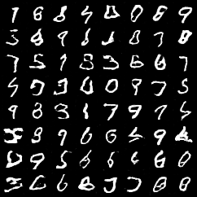

# SPS Generative AI - Assignment 1

This project implements a FastAPI application with bigram text generation and spaCy word embeddings.

## Features

- Bigram text generation
- Word embeddings using spaCy `en_core_web_lg`
- FastAPI endpoints for model inference
- Docker deployment

## Run with Docker

Build the Docker image:

```bash
docker build -t sps-genai .
```

Run the container:

```bash
docker run -p 8000:80 sps-genai
```

Open the FastAPI documentation in a browser:

```text
http://127.0.0.1:8000/docs
```

## API Endpoints

### POST /generate

Example request:

```json
{
  "start_word": "the",
  "length": 10
}
```

### POST /embedding

Example request:

```json
{
  "word": "apple"
}
```

The `/embedding` endpoint returns the input word and its embedding vector generated using spaCy `en_core_web_lg`.

## Assignment 3: GAN Image Generation

### Architecture

The GAN is implemented in PyTorch.

- Generator: 100-dimensional noise → Linear (7×7×128) → reshape
  → ConvTranspose2d (128→64, kernel 4, stride 2, padding 1)
  → BatchNorm2d → ReLU
  → ConvTranspose2d (64→1, kernel 4, stride 2, padding 1)
  → Tanh.
- Discriminator: Conv2d (1→64, kernel 4, stride 2, padding 1)
  → LeakyReLU(0.2)
  → Conv2d (64→128, kernel 4, stride 2, padding 1)
  → BatchNorm2d → LeakyReLU(0.2)
  → Flatten → Linear → Sigmoid.

### Training

The model was trained on the MNIST training set for 20 epochs,
using a batch size of 128, binary cross-entropy loss, and Adam
optimizers with learning rate 0.0002 and betas (0.5, 0.999).
Images are normalized to [-1, 1] to match the generator's Tanh output.

Run training from the project root:

```bash
python -m app.train_gan
```

Training saves generator weights to `gan_generator.pth` and
sample grids to `gan_samples/`.

### Generated Samples



The generated samples show varied digit shapes, although some
digits remain distorted. This is an unconditional GAN, so the
generated digit cannot be selected by label.

### API

`GET /generate-digit` returns a randomly generated 28×28 digit
as a PNG image.

Run locally:

```bash
python -m uvicorn app.main:app --reload --port 8000
```

### Docker

```bash
docker build -t sps-genai .
docker run --rm -p 127.0.0.1:8000:80 sps-genai
```

Open http://127.0.0.1:8000/generate-digit to generate an image.

### Validation

- Generator and discriminator output shapes checked.
- MNIST training completed for 20 epochs.
- Local API successfully returned generated PNG images.
- Docker image built and the container API successfully returned
  a generated image.